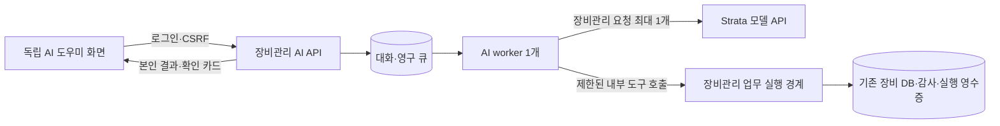

# 일반 사용자 AI API·대화 저장·단일 처리 큐 계획

## 1. 목적과 이번 작업 범위

Strata 웹 화면 임베딩은 시험용이었다는 사용자 설명을 기준으로 계획한다. 기존 Strata 화면과 별도로 작성하는 장비관리 AI 화면에서 사용자별 대화를 저장하고 Strata 모델 API를 호출한다. AI의 업무 권한은 일반 사용자의 현재 권한 이내로 제한한다. 자신의 장비 등록·수정과 카탈로그 등록 신청을 포함하며 삭제 도구는 제공하지 않는다. 장비관리 시스템에서 보낸 진행 중 모델 요청을 최대 1개로 제한하고, 장비관리 내부 요청의 순서만 관리한다.

사용자 정정에 따라 다른 서비스의 Strata 요청은 이 큐의 관리 대상에서 제외한다. 공통 큐 편입, 다른 클라이언트 변경, Strata 전용화, 전역 점유/순서 통제를 요구하지 않는다. 초기안의 공통 진입점·전용 서비스 조건과 기존 `/ai` 교체 제안은 철회하며 아래 독립 화면·내부 큐 설계를 현재안으로 적용한다.

이번 작업은 소스 조사, 설계, 검토 문서 작성이다. 앱 코드·운영 DB·Nginx·Strata 설정을 변경하거나 모델을 실행하지 않는다. 아래 경로·테이블·도구·수치는 모두 구현 제안이며 현재 구현된 것으로 해석하지 않는다. 구현과 배포는 별도 작업이다.

## 2. 확인한 현재 구조와 설계에 미치는 영향

| 확인 사항 | 소스 근거 | 계획 반영 |
| --- | --- | --- |
| 현재 `/ai`, `/ai/console`, `/api/strata/*`는 관리자용 Strata 화면·인증 프록시 | `utils/strata_integration.py`, `static/js/strata_page.js` | 기존 화면/경로와 별개인 `/assistant` 및 `equipment_ai` 메뉴를 제안한다. 기존 시험 화면의 교체·일반 사용자 개방은 이번 작업 범위가 아니다. |
| 기존 대화 보관은 브라우저 저장소를 인증 namespace로 분리하는 방식 | `static/js/strata_bridge.js` | 서버의 사용자 소유 대화 저장소를 새로 둔다. 기존 localStorage를 서버 대화로 자동 수입하지 않는다. |
| 일반 사용자 장비 생성·수정, 소유권 검사, 공개/임시저장 구분과 감사 이력이 존재 | `app.py`의 `add_equipment`, `update_equipment`, `utils/roadmap_equipment.py` | HTTP 핸들러를 무작정 호출하거나 SQL을 생성하지 않고 공통 업무 서비스로 재사용한다. |
| 카테고리·제조사·노드 신청은 일반 사용자일 때 승인 대기 생성 | `utils/catalog_request_routes.py`, `utils/catalog_request_service.py`, `utils/lineup_node_service.py` | AI는 신청까지만 수행한다. 접수를 승인 완료라고 안내하지 않는다. |
| 일반 사용자 신규 옵션도 승인 요청, 장비와 함께 등록하면 임시저장될 수 있음 | `app.py`의 `handle_option_change`, `add_equipment`, `update_equipment` | 승인된 카탈로그/옵션 선택과 신규 신청을 구분하고 임시저장 결과를 표시한다. |
| 상태·첨부파일·CSV·설정 API가 추가 연결되어 있음 | `utils/roadmap_routes.py`, `utils/roadmap_equipment.py` | 기존 서비스와 제한을 단계별로 연결한다. 소스 파일 상단의 과거 candidate 설명만으로 미연결이라 판단하지 않는다. |
| WebMCP는 현재 화면 범위의 조회 도구 2개 | `static/js/webmcp.js` | 참고 계약으로 사용한다. 서버 AI 실행 경로를 브라우저 WebMCP 지원에 의존시키지 않는다. |
| 메뉴 권한, 현재 DB 역할, SessionToken·비활성 계정 검사가 존재 | `app.py`의 `login_required`, `check_menu_permission`, `utils/roadmap_routes.py`의 `actor` | 접수·조회·각 도구 실행·확정 시 재검사한다. 프롬프트에 적힌 사용자/역할은 권한 근거가 아니다. |
| 코드 DB 계약은 v3, 장비 revision 증가 trigger가 존재 | `utils/database_contract.py`, `utils/roadmap_schema.py` | 실제 운영 버전은 이번에 열어 확인하지 않았다. 미래 migration은 실제 DB 확인 후 순차적 추가 migration으로 설계한다. |
| 알림/복원 조정용 파일 잠금은 있으나 AI 영구 큐는 없음 | `utils/roadmap_job_lock.py`, `app.py`의 DB 유지보수 경계 | 별도 AI 작업·점유 상태가 필요하다. 기존 알림 잠금을 AI 큐로 간주하지 않는다. |

로컬 조사 기준 commit은 `cd93b1a61e130b6a7c1201414cf4a5aac15035c5`이다. 기존 미커밋 변경을 포함한 현재 파일을 읽었으며 운영 서버에 동일하게 적용되어 있다고 단정하지 않는다. 운영 배치의 마지막 기록과 현재 상태 확인은 구분한다.

## 3. 기능 범위와 도구 목록

AI 메뉴 접근 권한과 업무별 메뉴/데이터 권한을 함께 검사한다. 일반 사용자용 도구 목록을 별도로 고정한다. 관리자가 이 화면을 열더라도 관리자 우회 권한이나 전체 장비 접근 권한을 이 도구에 상속하지 않는다. 공개 장비는 조회만 가능하며 타인 장비 수정은 차단한다.

| 기능 | AI 제공 방식 / 제안 도구 | 권한·확인·결과 | 도입 순서 |
| --- | --- | --- | --- |
| 자신의 장비·임시저장 검색, 상세, 기한·상태·이력 조회 | `search_my_equipment`, `get_my_equipment`, `get_my_equipment_summary` | 서버에서 소유자 고정, 페이지·필드 제한. 이력도 원래 조회 권한 범위 내 반환 | 2 |
| 공개 장비 검색 및 비교, 승인된 카탈로그·옵션 조회 | `search_public_equipment`, `search_catalog` | 공개·정식 등록 조건과 메뉴 권한 적용. 불필요한 소유자 개인정보 제외 | 2 |
| 자신의 장비 신규 등록·임시저장 | `prepare_equipment_create` → 확인 카드 → 서버 확정 | 이름·옵션·시리얼·날짜·메모·공개 여부를 표시. 소유자는 현재 사용자. 누락값 질문, 임의 사양 추측 금지 | 3 |
| 자신의 장비 정보 수정·임시저장 정식 등록 | `prepare_equipment_update` → 확인 카드 → 서버 확정 | 변경 전후, 장비 ID, 필수 revision 검사. 정식 등록은 승인된 옵션 필요. 소유자 변경 필드 미제공 | 3 |
| 정상/대여/수리 상태 변경 및 복귀 | `prepare_equipment_status` → 확인 카드 → 서버 확정 | 기존 상태 전이·변경 사유·revision·소유권 검사. `DISPOSED` 전이는 초기 AI 범위에서 제외하고 수동 UI 유지 | 3 |
| 카테고리·제조사·라인업 노드 등록 신청 | `prepare_catalog_request` → 확인 카드 → 서버 확정 | 이름·상위 노드·카테고리·제조사와 승인 대기를 명시. 실제 요청 ID 반환 | 3 |
| 신규 옵션/사양 등록 신청 | `prepare_option_request` → 확인 카드 → 서버 확정 | 기존 `save_option`의 PENDING 정책. 승인 전 정식 장비 연결 제한을 유지 | 3 |
| 자신의 신청 처리 결과·반려 사유 확인 | `list_my_requests`, `get_my_request` | `RequesterId`를 서버에서 고정. 재신청은 기존 허용 절차에서 새 신청으로 준비하며 임의 기존 요청 수정/취소 도구를 만들지 않음 | 2 / 4 |
| 첨부파일 목록·허용된 다운로드, 사용자가 선택한 파일 첨부 | 조회/다운로드 링크, `prepare_attachment_add` | 업로드는 사용자 선택 파일의 서버 핸들만 받음. 소유권·파일 형식/크기 검사 후 확인. 모델에 원시 경로·전체 파일을 자동 제공하지 않음 | 4 |
| CSV 내보내기·가져오기 | `prepare_csv_export`, 기존 CSV preview → 확인 → commit | 내보내기는 허용 범위의 다운로드 링크. 가져오기는 현재 1 MiB/500행 검증·15분 preview·원자적 commit 계약 재사용. 큰 원본 CSV를 프롬프트에 넣지 않음 | 4 |
| 개인 화면 설정·기한 알림 수신 설정 | `prepare_my_preferences` | theme/layout 등 키 허용 목록만 수정. 알림 동의는 별도 명시 확인과 기존 이메일 인증 검사, 다른 설정 보존 | 4 |
| 비밀번호·이메일 인증·로그인 ID/계정 변경·탈퇴 | 기존 본인 설정 화면으로 안내 | 인증정보는 대화에서 받지 않으며 초기 AI 실행 도구에서 제외 | 수동 UI |
| 삭제·첨부 삭제·일괄 삭제·삭제 효과의 우회 변경 | 실행 도구 없음 | 장비·카탈로그·신청·파일·계정 삭제 및 타인 소유로 이전 차단. 작업 취소는 대기 작업 중단이며 업무 데이터 삭제가 아님 | 제외 |
| 승인/반려 결정, 사용자/권한 관리, 마스터 직접 변경·병합, 백업/복원, Strata 관리 | 실행 도구 없음 | 관리자 endpoint, 모델 load/config/MCP, 임의 SQL·HTTP·셸·파일 접근을 등록하지 않음 | 제외 |

상태의 폐기 처리는 DB 삭제와 다르지만 사용자 의도를 보수적으로 반영하여 초기 AI 대상에서 뺀다. 대화는 새 대화/이름 변경/보관 기능을 먼저 제공하고, 삭제 요청은 이번 기능 범위를 확대하지 않고 보존·개인정보 정책과 함께 별도로 정한다.

## 4. 연결 구조와 책임

| 화면 요소 (신규 제안) | 장비관리 AI 화면의 구성 | 기존 Strata 화면과의 관계 |
| --- | --- | --- |
| 메뉴·경로 | `equipment_ai` 메뉴, 표시명 `AI 도우미`, `/assistant` | 기존 `strata` 메뉴와 `/ai`, `/ai/console`을 교체하지 않음 |
| 템플릿·자산 | `templates/equipment_ai.html`, `static/js/equipment_ai.js`, 필요 시 화면 한정 CSS | Strata HTML·vendor JS·iframe·`strata_bridge.js`를 대화 UI로 재사용하지 않음 |
| 사용자 기능 | 본인 대화 목록/새 대화/이어보기, 입력·진행 상태, 장비/신청 결과, 변경 확인 카드 | 장비관리의 로그인·내비게이션·테마 등 공통 틀과 업무 흐름에 맞춰 신규 작성 |
| 데이터·API | 서버의 본인 소유 대화, `/api/ai/*` | Strata 브라우저 localStorage 및 관리자 `/strata/` 프록시와 분리 |

경로·파일명은 구현 제안이다. 현재 소스의 관련 경로/식별자를 읽기 전용 검색한 범위에서 충돌을 찾지 못했으며 구현 시 등록 route와 다시 대조한다.

- 브라우저는 장비관리의 동일 출처 `/api/ai/*`만 호출한다. Strata 주소·키·공용 관리 API를 브라우저에 넘기지 않는다.
- AI worker는 장비관리 서버의 별도 서비스로 운영한다. 기존 Flask 요청 처리 프로세스에서 긴 모델 호출을 붙잡지 않는다. `app.py` import는 DB 초기화/스레드/프로세스 내부 유지보수 상태에 영향을 줄 수 있으므로 worker에서 하지 않는다.
- 첫 버전 브라우저 갱신은 짧은 polling을 사용한다. foreground 약 2초, 숨김/오류 시 간격 증가, terminal 상태에서 중지하며 한 번에 polling 요청 1개만 유지한다. worker→Strata는 SSE를 소비하되 웹 요청은 빠르게 반환한다. 웹→브라우저 SSE는 별도 비동기 전달 계층 도입 시의 후속 선택지다.
- 생성 조각은 토큰마다 DB transaction을 만들지 않고 시간/크기 기준으로 묶어 저장한다. 초기 제안은 약 1초 또는 4 KiB이며 최종 답변·완성된 도구 호출·상태 전이는 즉시 확정한다. crash 직전 미저장 조각은 부분 생성으로 취급하고 완성된 명령으로 재구성하지 않는다. 조회는 cursor·페이지 제한으로 수행한다.
- 도구 실행은 기존 장비관리 프로세스의 전용 내부 경계에서 수행한다. loopback/Unix socket 등 외부에서 차단된 경로와 별도 서비스 인증을 사용하며, 작업에 묶인 사용자 위임도 함께 검증한다. 서비스 키 하나로 임의 `user_id`·URL·메서드·SQL을 실행할 수 있는 범용 프록시는 금지한다.
- 등록·수정 등 핸들러 내부 로직을 부작용 없는 업무 서비스로 분리해 기존 UI와 AI가 함께 사용한다. 기존 입력 검증, 승인 대기, 감사, DB 유지보수 경계를 그대로 적용한다. worker의 장비 DB 직접 쓰기와 유지보수 gate 우회는 허용하지 않는다.
- Strata와 장비관리 서버 간 통신은 서버에서만 허용한다. 기존 후보의 `http://192.168.0.14:8080`은 마지막 기록일 뿐 현재 보안 상태 확인이 아니다. 구현 시 고정 upstream·API key와 함께 TLS/인증 터널 또는 동등한 보호 채널을 확정한다. 브라우저 HTTPS만으로 내부 서버 간 HTTP까지 암호화되었다고 보지 않는다.

## 5. Strata 모델 API 활용

권장 인터페이스는 `POST /v1/chat/completions`이다. 장비관리에서 `messages`, 제한된 `tools`, 출력 상한, 고정 모델 설정을 구성하고 Strata는 생성만 담당한다. `tool_calls`의 이름·인자를 장비관리에서 검증하고 허용된 도구를 실행한 뒤 결과를 `tool` 메시지로 전달한다. 변경 확정은 모델의 추가 판단 없이 서버 확인 경로가 수행한다.

상위 저장소 공식 자료는 Chat Completions의 도구 호출·스트리밍 및 상태 조회를 설명하고 있다. 그러나 장비관리의 UI 사본은 2026-10-30의 R7-260 작업 사본(app 0.2.6)이며, 상위 `main`과 설치본이 같은 API라는 증거는 아니다. 배포본 commit, 선택 모델, 템플릿, 실제 응답 계약을 1단계에서 고정한다.

| 항목 | 설계 결정 | 구현 전에 확인할 조건 |
| --- | --- | --- |
| 모델 식별 | 서버 설정의 승인된 모델 ID, 사용자 임의 모델/URL 변경 금지 | `/v1/models` 응답과 실제 모델·템플릿 일치 |
| 도구 호출 | 작업별 최소 도구만 전달, 인자/결과 크기 제한, 서버 재검증 | `tools`, `tool_calls`, 도구 결과 재입력과 finish reason을 설치본으로 시험 |
| JSON·도구 조합 | 기본은 도구 인자의 로컬 스키마 검증. structured output 지원을 권한·정합성 보장으로 간주하지 않음 | 현재 상위 코드에는 structured `response_format`와 tools/MCP 동시 사용 거부가 있으므로 이 조합에 의존하지 않음 |
| 스트림 | 완성된 도구 호출과 정상 완료를 받은 뒤 검증. 일부 인자 조각/추론 텍스트를 실행하지 않음 | SSE 분할·UTF-8·중단·토큰 상한 종료·중복 조각·도구 여러 개 응답 |
| Strata 내부 MCP | 모든 요청에서 `strata_mcp` 비활성. 장비관리의 자체 도구 실행기만 사용 | upstream 설정/기본값 변경 시에도 내부 MCP 자동 실행이 없는지 확인 |
| 상태·취소 | 장비관리에서 보낸 요청의 응답 완료/개별 취소 결과로 내부 처리 상태를 전이. 공유 서버의 전체 idle 여부를 배정 조건으로 사용하지 않음 | 자체 요청 식별·완료·취소 계약을 설치본으로 시험. 식별할 수 없는 요청 취소·서버 전체 중단·다른 서비스 상태 제어는 제외 |
| 성능 | 업무에 필요한 짧은 문맥·요약·검색, 제한된 출력/도구 회수 | 실제 장비의 prefill/첫 토큰/완료 시간을 별도로 측정. 이전 5650U/Hermes 수치로 현재 Strata 지연을 약속하지 않음 |

도구 호출 형식·품질이 미달하면 해당 쓰기 기능은 비활성 상태로 유지한다. 자유 문장을 명령으로 해석해서 우회 실행하거나 형식 오류를 성공으로 보정하지 않는다. JSON 제한을 쓸 수 있더라도 소유권·현재 값·확인은 별도로 검사한다.

공식 참고: [Strata API 설명](https://github.com/Niko1221/Strata/blob/main/docs/DETAILS.md), [Strata HTTP 서버 소스](https://github.com/Niko1221/Strata/blob/main/serve/server.py). 확인일 2026-11-04. 이 자료는 인터페이스 설계 근거이며 설치본 검증 결과가 아니다.

## 6. 사용자별 대화와 인증 수명

| 저장 대상 | 제안 저장 위치 / 주요 필드 | 불변 조건 |
| --- | --- | --- |
| 대화 | 전용 `instance/ai/ai.sqlite3`: conversation ID, owner ID, 제목, 상태, 생성/수정 시각 | 모든 조회/변경은 `owner_id=현재 사용자` 조건. UUID를 알아도 타인 데이터 접근 불가 |
| 메시지·도구 결과 | message ID, conversation ID, turn ID, 순서, role, tool call ID, 본문, completed/partial 상태 | 사용자 입력은 접수 성공 전에 저장. 완료/실패/부분 생성 구분. 원본 대화와 문맥 요약 구분 |
| 작업·대기열·진행 이벤트 | job/step ID, owner ID, queue 순번, 상태, lease/fencing 번호, 자체 upstream 요청 상관 ID, 시각, 재시도 수, 취소, event cursor | 대화별 턴 순서, 중복 접수 키, 장비관리 발신의 진행 중 모델 요청 최대 1. event 조회도 소유자 검사 |
| 작업별 위임·확인 제안 | 기존 장비 DB의 위임·확인 원장: actor, login/session 식별 해시·유효기간, 허용 도구, 정확한 대상/인자 hash, 예상 revision, 만료/소비 상태. AI DB에는 참조만 저장 | 확인 소비와 업무 변경을 같은 transaction으로 확정. 브라우저 쿠키/원문 SessionToken/비밀번호를 모델이나 worker 요청 본문에 전달하지 않음. 확인 위조·재사용 불가 |
| 업무 실행 영수증·결과 outbox | 기존 장비 DB에 추가 migration: actor/job/operation ID, 인자 hash, 결과 ID, 상태, 감사 참조 | 업무 데이터·감사·영수증을 같은 writer transaction에서 commit. 대화 DB 반영 실패 시 영수증으로 복구 |

전용 AI DB는 장비 DB와 같은 장비관리 서버의 로컬 디스크에 둔다. 사용자 ID는 논리 참조이므로 계정 삭제·복원·ID 재사용 시 DB 세대 식별자도 검사한다. 서로 다른 DB 사이에 외래키나 원자적 commit이 있다고 가정하지 않는다. 계정/DB 세대가 불명확하면 자동 소유자 재결합을 금지한다.

AI 메뉴에는 본인의 대화 목록, 새 대화, 과거 대화 재개를 제공한다. 페이지 재접속·다른 탭에서도 같은 job을 조회한다. 브라우저를 닫아도 서버 저장 대화는 유지된다. 다른 계정 로그인 시 이전 계정 화면/캐시를 즉시 지우고 기존 대화를 제공하지 않는다.

작업 접수 시 서버가 현재 로그인·만료 시각에 묶인 제한 위임을 만든다. 큐 대기 후·매 도구 호출 전·변경 확정 전에 현재 DB 계정 상태, SessionToken 일치, 메뉴 권한, 위임 만료를 다시 검사한다. 기존 logout/강제 로그아웃/재로그인/권한 변경과 위임 취소를 연결한다. AI polling이나 worker 진행으로 로그인 유효기간을 자동 연장하지 않는다.

현재 `static/js/session_timer.js`는 성공한 일반 fetch마다 화면 타이머를 리셋하고, `app.py`는 30분 permanent session을 사용한다. Flask의 요청별 cookie 갱신 기본 동작도 함께 고려해야 한다. 구현에서는 AI job/event 상태 조회를 수동 사용자 활동과 구분해 공통 타이머 리셋에서 제외하고, 서버 세션 저장 경계에서도 이 자동 상태 조회의 만료 재발급을 제외한다. 로그아웃/유효하지 않은 세션의 cookie 삭제 응답은 정상 유지한다. 기존 `/api/check_session` 주기 조회와의 상호작용, 다른 화면의 기존 연장 동작을 회귀 검증한다. 작업 위임은 서버가 기록한 절대 만료를 별도로 검사하고 모델/폴링이 갱신할 수 없게 한다. [Flask session 갱신 설정](https://flask.palletsprojects.com/en/stable/config/#SESSION_REFRESH_EACH_REQUEST).

세션이 만료되면 대기 작업·미확정 제안을 중지하고 재로그인을 안내한다. 실행 중인 자체 모델 요청은 후속 업무 실행을 차단하고, 요청별 취소 또는 해당 응답 완료 확인까지 내부 점유를 유지한다. 공유 Strata 서버나 타 서비스 요청은 중단하지 않는다. 이미 commit된 업무는 실패/취소라는 이유로 다시 실행하거나 자동 되돌리지 않고 실제 결과를 영수증으로 복구한다. 재로그인 후 과거 대화는 읽을 수 있으나 예전 확인 권한을 부활시키지 않고 현재 값으로 새 미리보기를 만든다.

문맥은 해당 대화의 완료 메시지·짝이 맞는 도구 호출/결과와 필요한 최신 조회 결과만 구성한다. 다른 사용자 대화, 전체 장비 목록, 비밀번호/인증 PIN/쿠키/API key는 포함하지 않는다. 오래된 요약은 참고이며 현재 DB 사실이나 사용자 확인을 대체하지 않는다. 원시 내부 추론 내용은 사용자 대화로 장기 저장하지 않고 진행 상태·최종 답변·도구 결과를 남기는 것을 기본으로 한다.

대화와 업무 감사는 보존 목적을 분리한다. 초기 제안은 서버 대화 지속 보관, 보관 처리, 사용자/전체 용량 제한·사전 안내이며 임의 자동 삭제를 켜지 않는다. 외부 공개 전 대화 보존 기간·백업 보관·탈퇴/개인정보 처리 정책을 확정해야 한다. 대화 DB·큐·로그·첨부는 Git에 포함하지 않으며 제한된 서버 계정만 접근한다.

## 7. 변경 실행: 미리보기 → 본인 확인 → 서버 확정

1. 사용자 의도를 읽고 필요한 본인 장비/카탈로그를 조회한다. 이름이 같은 장비는 ID·모델·시리얼 일부로 구분하고 대상이 불명확하면 선택을 요청한다.
2. 모델은 변경 제안을 만들 수 있다. 서버가 허용 필드·소유권·승인 상태·입력 형식·revision을 검증하여 확정된 확인 카드를 저장한다. 모델에게 실행 권한을 주는 토큰은 전달하지 않는다.
3. 확인 카드는 대상, 변경 전후, 공개 여부, 신청/임시저장 부작용, 작업 개수, 유효기간을 표시한다. 초기 확인 유효기간 제안은 15분이며 만료 시 현재 값으로 다시 준비한다. 대화의 "예", 모델 출력, 과거 확인을 실행 승인으로 재활용하지 않는다.
4. 현재 로그인한 본인이 확인 카드의 실행 버튼을 누르면 CSRF·출처·소유자·위임·미소비 상태를 검사한다. AI 생성 대기열을 거치지 않고 짧은 서버 업무 transaction으로 확정한다. GPU를 다시 쓸 필요는 없으며 후속 설명만 모델 큐에 들어간다.
5. 같은 transaction에서 현재 소유권·revision·메뉴 권한·승인 옵션을 재검사하고 업무 변경, 감사, 확인 소비, 실행 영수증을 함께 기록한다. 기존 `update_equipment`는 revision 입력이 선택적이지만 AI 확정에는 필수로 강제한다. trigger 또는 기존 서비스 증가 방식과 충돌하지 않게 적용한다.
6. 동일 실행 키의 재전송은 같은 결과를 반환한다. 동일 키에 다른 인자는 거부한다. 결과 수신 중 연결이 끊겼으면 영수증을 먼저 조회하고 변경을 자동 반복하지 않는다. DB 변경 성공 여부를 모르면 `result_unknown`으로 표시한다.
7. 장비관리 결과 ID/신청 ID/현재 상태를 UI가 직접 표시한다. 모델이 후속 요약을 생성하지 못해도 실제 성공 결과가 사용자에게 남는다. 승인 신청 접수와 관리자 승인 완료를 구분한다.

여러 변경은 최초에 개수와 항목을 보여 주고 선택 가능한 카드로 나눈다. CSV처럼 기존 전체 성공/전체 취소 계약이 있는 경우만 그 계약을 유지한다. 이미 일부 확정한 복합 업무를 대화 실패 때문에 되돌렸다고 주장하지 않는다. 삭제는 확인 카드가 있어도 실행할 수 없도록 도구 등록·실행 경계 양쪽에서 차단한다.

## 8. 장비관리 내부 요청의 단일 처리 영구 큐

권장안은 장비관리 서버의 SQLite 영구 큐와 별도 worker 1개다. Python 메모리 queue는 재시작 시 대기 요청이 사라지므로 상태의 원장으로 사용하지 않는다. Redis/Celery는 여러 worker/노드가 필요한 단계의 대안으로 보류한다. 현재 Flask/requests/sqlite3 기반을 활용하고 새 외부 의존성은 우선 추가하지 않는다.

순서·공정성·취소·동시성 제어는 장비관리 내부 job에만 적용한다. 다른 서비스는 기존 방식대로 Strata를 호출하며 장비관리의 허가를 받을 필요가 없다. 장비관리 큐는 공유 Strata 전체의 처리 순서·점유·처리 시간을 보장하지 않는다.

SQLite WAL은 로컬 여러 프로세스의 읽기/짧은 쓰기를 위한 선택이다. 쓰기 transaction은 한 번에 하나이므로 claim/이벤트 저장을 짧게 하고 inference 동안 DB transaction을 열어 두지 않는다. busy timeout, 조건부 상태 변경, 적절한 인덱스, checkpoint·디스크 감시를 둔다. WAL은 네트워크 공유 DB 용도로 사용하지 않으며 두 DB 전체의 원자성을 보장하지 않는다. [SQLite WAL](https://www.sqlite.org/wal.html), [transaction 계약](https://www.sqlite.org/lang_transaction.html).

| 항목 | 권장 정책 |
| --- | --- |
| 동시성 | 장비관리에서 전송한 진행 중 Strata 요청 최대 1개. 앱 worker 단일 서비스 + 원자적 claim + 자체 OS/DB 점유 확인으로 중복 worker도 방어. 다른 서비스 요청 수는 제어하지 않음 |
| 사용자 공정성 | 사용자별 진행 중인 대화 턴 최대 1개, 추가 대기 1개부터 시작하는 제안. 사용자별 한 개의 실행 가능 후보를 둔 FIFO로 사용자/여러 대화 간 독점 방지 |
| agent 여러 단계 | 한 번의 모델 응답을 한 처리 단위로 삼음. 도구 결과 뒤 추가 추론이 필요하면 대기열 뒤로 재진입하여 다른 사용자와 교대. 같은 대화의 턴 순서는 보존 |
| 확인·추가 입력 대기 | `waiting_confirmation`/`waiting_input`에서는 모델 요청/lease를 점유하지 않음. 기다리는 동안 다른 사용자 처리. 새 사용자 입력/확인 후 필요할 때만 이어감 |
| 접수 | 본인 인증·AI 메뉴·본문 제한·대화 소유권·중복 키 검사 → 영구 저장 → `202`와 job ID. 포화 시 `429`/재시도 안내. 접수 성공처럼 보인 뒤 작업을 잃지 않음 |
| 화면 표시 | 본인 요청의 내부 대기 순서와 대기/응답 대기/생성/확인 대기/완료/실패/취소 상태. 다른 서비스까지 포함한 전체 대기 순위는 표시하지 않음. 원인을 알 수 없는 지연은 응답 대기로 안내 |
| 취소 | 대기 중은 원자적으로 취소. 실행 중은 `cancel_requested` 후 해당 요청의 개별 취소 결과 또는 응답 완료를 확인해야 내부 점유 해제. 확정 transaction과 취소가 경합하면 실제 영수증 결과 우선 |
| 재시작 | lease 만료만으로 재전송하지 않음. 기존 자체 worker·발신 요청 상관 ID·결과 기록을 먼저 대조. 자체 요청의 종료가 불명확하면 복구 필요로 격리하고 내부 재전송을 보류. 공유 서버 전체 idle 조회나 재시작으로 해결하지 않음 |
| Strata 혼잡·장애 | 자체 HTTP 요청의 대기/오류와 재시도 지시에 따라 장비관리 요청만 대기·backoff. 전송 전 실패는 제한 재시도, 결과 불명은 자체 기록으로 복구. 외부 작업을 중단하거나 모델을 재시작하지 않음 |
| 복원/점검 | 신규 dispatch·확정 중지, 진행 작업 정리, DB 세대 변경 후 예전 제안/위임 무효화. 큐만 복구하여 과거 업무를 다시 적용하지 않음 |
| 다른 Strata 클라이언트 | 큐 편입·공통 admission·전용 서비스 분리·우선순위 변경·외부 요청 취소를 요구하지 않음. 해당 서비스의 요청과 운영은 이번 제어 범위 밖 |

개별 취소 API를 지원하지 않으면 사용자에게 취소 요청을 표시하고 후속 도구/업무 실행을 차단한 상태로 자체 응답을 끝까지 정리한다. 서버 전체 stop/unload/restart로 대체하지 않는다. worker crash로 응답 연결을 잃어 자체 요청의 종료 여부를 확인할 수 없다면 요청을 복구 필요로 남기고, 자동 중복 전송 없이 내부 큐를 안전하게 재개할 조건을 API 계약 시험에서 정한다. 다른 서비스의 작업을 식별하거나 조작하는 복구 절차는 만들지 않는다.

초기 안전 상한 제안은 사용자 메시지 8,000자, 제한된 조회 결과 20개 단위, 1턴 모델 호출 최대 6회, 전체 열린 작업 최대 20개다. 입력 토큰 예산·출력 상한은 모델의 문맥/생성 능력과 실제 측정 후 고정한다. 수치는 아직 성능 측정에 근거한 운영 설정이 아니며 1단계에서 조정한다. 상한에 도달하면 이미 처리된 결과와 다음 행동을 알리고 종료한다. 알려진 결과·저장된 입력을 버리지 않는다.

시간은 내부 `queue_wait`, `connect`, Strata 응답 대기, 확인 가능한 `prefill/first_token`, `generation`, `tool_time`, `confirmation_wait`로 구분한다. 내부 대기 시간을 모델 요청 시간 초과로 계산하지 않는다. 자체 응답에서 구분할 수 없는 upstream 대기와 prefill을 임의로 나누거나 다른 서비스 실행 중이라고 추정하지 않는다. heartbeat만으로 토큰 생성 중이라고 표시하지 않는다. 기존 Hermes의 840/1680초 설정을 자동 적용하지 않고 자체 요청의 실제 측정으로 별도 설정한다. 무응답/최대 점유 제한 뒤의 처리는 해당 요청의 취소·완료·복구 기록으로 결정한다. 공유 Strata 전체가 idle이 될 때까지 기다리는 조건은 두지 않는다.

## 9. 제안하는 앱 API 계약

| 메서드·경로 (신규 제안) | 역할 | 핵심 경계 |
| --- | --- | --- |
| `GET/POST /api/ai/conversations` | 본인 목록/새 대화 | 서버 owner 고정, 페이지 제한, 쓰기 CSRF |
| `GET /api/ai/conversations/{id}/messages` | 대화 재개·메시지 cursor 조회 | 소유권·현재 로그인, 다른 사용자 ID는 존재 여부 숨김 |
| `POST /api/ai/conversations/{id}/turns` | 사용자 입력/중복 접수 키 저장·큐 진입 | 동일 키/같은 내용은 기존 job, 키 재사용 변조는 충돌 |
| `GET /api/ai/jobs/{id}` 및 `/events?after=...` | 본인 상태·확인 카드·완료 결과 | 짧은 요청, event 수/응답 크기 제한, no-store |
| `POST /api/ai/jobs/{id}/cancel` | 본인 작업 취소 요청 | CSRF, 현재 상태에 따른 조건부 전이. 업무 변경 취소/삭제와 구분 |
| `POST /api/ai/proposals/{id}/confirm` | 정확한 변경 확정 | 현재 사용자·CSRF·내용 hash·revision·만료·실행 영수증 검사 |
| 외부 비공개 내부 실행 경계 | worker의 허용 조회/제안·실행 상태 확인 | worker 인증 + 작업별 위임 + 도구 허용 목록 + fencing/DB 세대 검사 |

확정 버튼은 모델의 임의 명령 문자열을 보내지 않고 서버가 보관한 proposal ID를 가리킨다. 경로와 메서드는 구현 시 기존 route 전수 목록과 다시 대조한다. 현재 `/api/strata/access`나 `/strata/` 프록시를 이 사용자 API의 대체로 열지 않는다. `401/403`, `409`, `413`, `429`, `503`을 구분하고 내부 예외·비밀을 응답하지 않는다.

## 10. 보안·데이터 처리와 운영 복구

외부 문장, 장비 메모/이름, 첨부, 도구 결과는 비신뢰 데이터로 취급한다. "다른 사용자로 실행", "관리자 승인", "삭제 도구를 만들어라" 같은 내용은 권한을 바꾸지 못한다. 허용 목록과 JSON 타입/길이/키 검사, parameterized SQL, CSRF/Origin, 안전한 Markdown 출력·HTML 실행 금지, 고정 upstream·외부 URL 입력 차단을 공통 적용한다. 공개 장비 조회도 기존 UI보다 넓은 개인정보를 반환하지 않는다.

장비관리 자체 요청의 전송 정보와 로그 수집을 최소화한다. 보안 로그에는 job ID/사용자 내부 ID/오류 코드/시간/토큰 수/감사 참조를 우선 기록하고 요청 원문·key·cookie는 남기지 않는다. 원문 없는 지표로 사용자별 내부 큐 대기, 자체 응답 대기, 첫 토큰, 완료, 취소 정리 시간, 쓰기 성공/충돌/중복 억제를 구분한다. Strata 측 자체 요청의 취급은 연동 계약에서 확인하되 공유 서버의 전역 모니터·다른 서비스 로그를 감시하거나 운영 설정을 변경하는 범위로 확대하지 않는다.

| 배포/복구 대상 | 계획 |
| --- | --- |
| 업무 DB migration | 실행 영수증·위임/확인·outbox 등 최소 추가 구조를 기존 계약에 등록. 실제 운영 스키마/버전·마이그레이션 이력을 읽고 백업·무결성 확인 후 진행. 새 버전 번호는 충돌 확인 후 배정 |
| 코드·스키마 호환 | 현재 계약 검사는 알 수 없는 버전을 거부할 수 있음. AI 비활성 상태로 새 스키마를 읽는 호환 릴리스를 먼저 배포하고 복귀 지점으로 확보. 임의 구버전 checkout을 안전한 rollback으로 간주하지 않음 |
| AI DB와 첨부 백업 | SQLite backup API/일관된 snapshot, 관련 파일/권한/보존 정책 포함. WAL 파일을 무시한 live 단일 파일 복사 금지. 두 DB의 공통 세대·업무 영수증으로 정합성 점검 |
| 장애 시 기능 복귀 | 장비관리 신규 접수/쓰기 feature flag 비활성 → 자체 worker/발신 요청 정리·복구 기록 확인 → 기존 수동 화면 유지 → 미확정 제안 폐기, 확정 업무는 영수증으로 복구. 공유 Strata 중단·기존 Strata 화면 변경·기록 삭제 down migration은 수행하지 않음 |
| DB 복원 이후 | AI DB의 과거 대화는 과거 기록으로 표시. 새로운 DB 세대에서 큐/확인/위임 무효화, 자동 재실행 금지. 조회하여 현재 사실 재구성 |
| 변경 설정 | 제안 flag: `USER_AI_ENABLED`, `USER_AI_READ_TOOLS`, `USER_AI_WRITE_TOOLS`를 독립 운영. 기존 `STRATA_ENABLED` 관리자 테스트 경로와 분리. 스트림 도중 배포/권한 변경도 쓰기 경계에서 재검사 |

확인 대기/대화 보관 정책, 장비관리와 Strata 사이 보호 채널, 자체 요청 식별·취소·복구 계약, 내부 대기 상한/모델 출력 예산은 구현 착수 시 확정할 설정이다. 다른 서비스를 공통 큐로 옮기거나 Strata를 전용화하는 조건은 두지 않는다. 삭제 차단과 일반 사용자 한정은 유지한다.

## 11. 구현 순서와 완료 기준

| 단계 | 작업 | 다음 단계 진입 기준 |
| --- | --- | --- |
| 1. 계약·기반 준비 | 배포 Strata의 도구/스트림과 자체 요청 식별·완료·개별 취소/복구 시험, 일반 사용자 권한 목록 고정, queue/대화 schema·위임·복원 세대 설계, 격리 Linux Staging | 장비관리 내부 제어와 API 계약·시간 예산 확정. 앱/DB 기존 동작 보존과 migration·rollback 검증. 외부 클라이언트 변경은 진입 조건이 아님 |
| 2. 대화·큐·조회 | 독립 `/assistant` 화면·`equipment_ai` 메뉴·신규 템플릿/JS, 본인 대화 저장, worker 1개, polling, 본인/공개 조회·내 신청 상태 | 두 사용자/여러 탭 격리, 재접속/만료, 내부 큐 공정성·복구·취소, 기존 Strata 시험 화면과의 독립성 검증 |
| 3. 핵심 변경 | 공통 업무 서비스, 내용 고정 확인, 영수증/중복 방지, 본인 장비 등록·수정·상태와 카테고리/제조사/노드/옵션 신청 | 미확인 쓰기 0건, 타인/삭제/관리자 실행 0건, 재전송 중복 0건. 실제 모델의 도구·업무 시나리오 합격 |
| 4. 일반 기능 확대 | 파일 첨부·CSV·개인 설정·복합 신청/임시저장 이어가기 | 기존 파일/CSV/알림 동의 검증 보존. 부분 성공·용량·확인 UX 검증 |
| 5. 제한 공개와 운영 | AI 쓰기 OFF → 조회 공개 → 소수 사용자 쓰기 → 확대. 기능별 차단 flag·지표·복원 연습 | Linux Staging 통과와 별도 운영 반영 절차 완료. 위험 시 수동 UI와 보존된 기록으로 복귀 가능 |

## 12. 반드시 검증할 시나리오

| 범주 | 합격 기준 |
| --- | --- |
| 사용자 격리 | A가 B의 대화/job/event/확인/도구 결과 ID를 알아도 접근 실패. 여러 탭/계정 전환·재로그인에서 유출 없음 |
| 권한 | 본인 장비만 변경, 공개는 조회만. 관리자 역할로 접속해도 이 사용자 도구의 범위가 넓어지지 않음. 메뉴 차단·계정 비활성·만료·강제 로그아웃 즉시 반영 |
| 삭제 차단 | 직접 요청·우회 프롬프트·조작된 tool call·첨부 삭제·소유자 이전·관리자 endpoint 요청으로 실행 0건 |
| 변경 정확성 | 대상 혼동/동명이 장비·새 옵션 승인 대기·임시저장·공개 전환·날짜 오류·시리얼 중복·revision 충돌을 기존 규칙대로 처리 |
| 확인·중복 | 확인 전 쓰기 0건. 클릭/재시도/탭 중복·응답 유실·commit 직후 crash에도 업무 생성 1회. 변조/만료 proposal 거부 |
| 큐 | 장비관리 사용자 다중 턴/대화로 내부 순서 독점 불가. 확인 대기에 자체 요청 점유 없음. worker 2개/재시작/lease 만료에서도 장비관리 발신의 진행 중 모델 요청 최대 1. 타 서비스 동시 요청은 위반으로 판정하지 않음 |
| 취소·장애 | 자체 요청의 prefill 중 연결 끊김·취소·worker crash·응답 대기·결과 불명에서 중복 전송 차단 및 확정 결과 보존. 요청별 취소 미지원 시 응답 정리. 공유 Strata 재시작·타 서비스 요청 취소 0건 |
| 공유 서비스 경계 | 앱 테스트에서 별도 외부 클라이언트가 동시에 호출해도 경로/권한/순서를 변경하지 않음. 자체 요청의 대기·429/503/backoff만 처리하고 전역 idle을 배정 조건으로 요구하지 않음 |
| 독립 대화 화면 | `/assistant`의 신규 템플릿/JS·본인 대화 저장·확인 카드 동작 검증. Strata iframe/vendor 대화 UI 미사용, 기존 `/ai`·`/ai/console`·관리자 메뉴/권한 보존 |
| 모델 API·품질 | 분할/잘못된 tool JSON, 잘못된 도구, 토큰 상한, 여러 호출, 과도한 회수, 불충분한 정보에서 쓰기 미실행·질문/오류. 실제 모델 반복 시나리오로 합격하며 낮은 품질을 성공으로 재분류하지 않음 |
| 보안 | CSRF/XSS/SQL 인자/파일 변조/타입·본문 크기/외부 URL·경로 입력, 메모의 프롬프트 주입, Strata 모니터 원문·키 노출 없음 |
| 데이터·복원 | DB busy·디스크 full·두 DB 반영 실패·백업/복원·ID 재사용 시 데이터 보존, 원자적 업무/영수증, 오래된 큐 재실행 없음 |
| UX·성능 | 대기/첫 토큰/생성/확인/확정 결과 구분, 재접속으로 이어보기, 자동 중복 생성 없음. 실제 부하에서 대기·첫 토큰·완료·취소 정리 시간을 별도 기록 |

이 문서는 설계 검토의 대상이다. 기능 테스트·실제 API 호환성·실제 모델 품질·운영 성능을 통과했다는 보고가 아니다. 추가 읽기 전용 운영 확인과 Linux Staging 검증을 구현의 선행 조건으로 둔다.

## 관련 기록

- 작업: [Task](../../../../Tasks/2026/11/04/001_User_AI_API_Conversation_and_Queue_Task.md)
- 단계별 검토: [Report](../../../../Reports/2026/11/04/001_User_AI_API_Conversation_and_Queue_Report.md)
- 기존 쓰기 도구 선행 계획: `Plans/2026/09/29/001_Proposal037_Write_Tools_Readiness_Plan.md`. 확인·감사·중복 방지 원칙을 참고하며 관리자 기능 확장은 이번 범위에 포함하지 않는다.
- 기존 관리자 시험 기록: `Reports/2026/10/30/002_Strata_Admin_Integration_Report.md`. 이 기록의 배포 상태를 이번 일반 사용자 AI 기능의 완료 상태로 사용하지 않는다.
